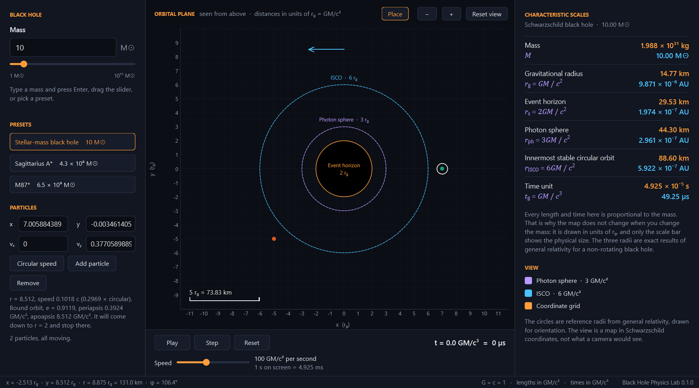

# Black Hole Physics Lab

An interactive numerical laboratory for black hole physics, built one validated step at a time:
from Newtonian gravity, through Schwarzschild and Kerr spacetimes, to electrical-engineering
laboratories on top of them (RF links, signal processing, radio interferometry).

**Status: early development — Stage 1, Checkpoint 1D-2.**
The roadmap, and the verification status of every physics model, are in
[PROJECT_PROGRESS.md](PROJECT_PROGRESS.md).



## What works today

- **Units and scales** (`bhlab.constants`, `bhlab.units`): SI constants with their sources,
  conversion between geometrized units (G = c = 1) and SI, and the characteristic radii and times
  of a non-rotating black hole of any mass.
- **Desktop window** (`python -m bhlab`): choose a mass by typing, by slider or by preset, and see
  every characteristic scale update live, each with its formula.
- **Map of the black hole** (`bhlab.ui.viewport`): the orbital plane seen from above, drawn in units
  of the gravitational radius GM/c², with the event horizon, the photon sphere and the innermost
  stable circular orbit. Drag to pan and turn the mouse wheel to zoom. A scale bar gives the physical
  size for the chosen mass, and the status bar reads out the cursor position in Cartesian and polar
  form. The map looks the same for every mass, because every length of the problem is proportional
  to the mass; only the scale bar changes. It is a map in Schwarzschild coordinates, not what a
  camera would see: the bending of light belongs to a later stage.
- **Newtonian orbits** (`bhlab.physics`, `bhlab.solvers`, `python -m bhlab.orbit`): equations of
  motion, RK4, velocity Verlet and adaptive DOP853 with events, orbital elements, all tested against
  Kepler's laws and exact solutions.
- **Particles in the window** (`bhlab.simulation`): enter a position and velocity, press Play, and
  watch the particles move in real time at an adjustable speed. Or switch on **Place** and drag on
  the map: press where the particle starts and drag an arrow for its velocity, while a preview tells
  you the orbit it will follow. Click a particle to select it, and remove it with Remove or Delete.
  A particle that reaches r = 2 GM/c² is stopped there: Newton's theory has no horizon, so that is
  where this model ends.
- **Automated tests**: 448 of them, for the physics, the solvers, the simulation and the window.

Not there yet: orbit trails, a panel for the selected particle, and relativity. Those arrive in later
checkpoints, each one tested before the next begins.

## Quick start (Windows)

```powershell
python -m venv .venv
.venv\Scripts\python.exe -m pip install -e ".[dev,prototypes]"
.venv\Scripts\python.exe -m bhlab
.venv\Scripts\python.exe -m pytest
```

Python 3.12 or newer is required.

## Using the physics without the window

```python
from bhlab.units import BlackHole

sgr_a = BlackHole.from_solar_masses(4.3e6)
sgr_a.schwarzschild_radius  # 1.27e10 m
sgr_a.time_unit  # 21.2 s, the time light needs to cross GM/c^2
sgr_a.length_to_si(6.0)  # the ISCO radius, 6 GM/c^2, in metres
```

## Prototypes

`prototypes/` holds the standalone scripts the project started from: a Schwarzschild orbit sandbox
and a ray-traced image of a black hole with an accretion disc. They run, but they are not part of
the tested package. See [prototypes/README.md](prototypes/README.md).
